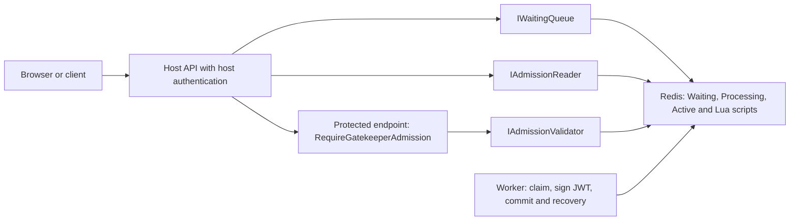
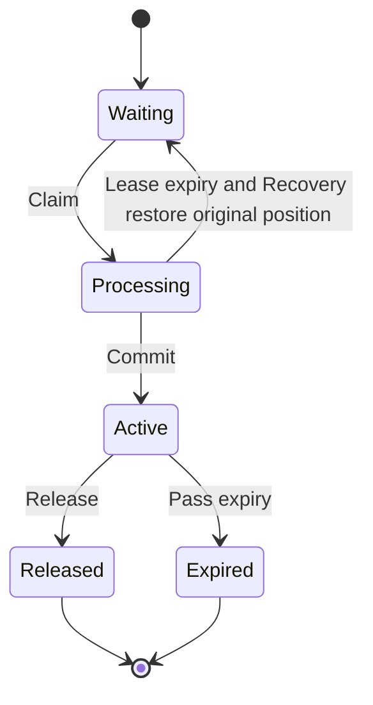

# Gatekeeper

Gatekeeper provides Redis-backed virtual waiting rooms and controlled admission for distributed .NET 10 applications. Hosts enqueue trusted identities; Workers reserve capacity, sign JWT admission passes and commit exact admission state in Redis. Optional ASP.NET Core authorization guards protected endpoints alongside the host's authentication.

[](https://github.com/abdelrahman-abusleem/Gatekeeper/actions/workflows/ci.yml)

## Quick start

Use a .NET 10 ASP.NET Core host with the packages below. Connect your host's existing login flow to cookie authentication and issue a trusted `ClaimTypes.NameIdentifier` claim for each user.

`appsettings.json`:

```json
{
  "ConnectionStrings": { "Redis": "localhost:6379" },
  "QueueSettings": { "MaxActivePasses": 50, "MaxWaitingUsers": 0, "MaxConcurrentAdmissions": 1 },
  "JwtSettings": { "Issuer": "your-admission-issuer", "Audience": "your-admission-consumers" }
}
```

Supply a Base64 signing key of at least 32 random bytes through configuration. For a temporary development key in PowerShell:

```powershell
$env:JwtSettings__SecretKey = [Convert]::ToBase64String([Security.Cryptography.RandomNumberGenerator]::GetBytes(32))
```

`Program.cs`:

```csharp
using System.Security.Claims;
using Gatekeeper.AspNetCore;
using Gatekeeper.Domain.Abstractions;
using Microsoft.AspNetCore.Authentication.Cookies;
using Microsoft.AspNetCore.Authorization;

var builder = WebApplication.CreateBuilder(args);
builder.Services.AddAuthentication(CookieAuthenticationDefaults.AuthenticationScheme).AddCookie();
builder.Services.AddAuthorization(options => options.DefaultPolicy = new AuthorizationPolicyBuilder()
    .RequireAuthenticatedUser().RequireClaim(ClaimTypes.NameIdentifier).Build());
builder.Services.AddGatekeeper(builder.Configuration);
builder.Services.AddGatekeeperAdmission(options =>
    options.UserIdResolver = user => user.FindFirstValue(ClaimTypes.NameIdentifier));

var app = builder.Build();
app.UseAuthentication();
app.UseAuthorization();
app.MapPost("/queue", (ClaimsPrincipal user, IWaitingQueue queue, CancellationToken cancellationToken) =>
    queue.EnqueueAsync(user.FindFirstValue(ClaimTypes.NameIdentifier)!, cancellationToken))
    .RequireAuthorization();
app.MapGet("/admission", async (ClaimsPrincipal user, IAdmissionReader reader, CancellationToken cancellationToken) =>
{
    var userId = user.FindFirstValue(ClaimTypes.NameIdentifier)!;
    return new
    {
        Status = (await reader.GetStatusAsync(userId, cancellationToken)).ToString(),
        Pass = await reader.GetPassAsync(userId, cancellationToken)
    };
}).RequireAuthorization();
app.MapGet("/protected", () => Results.Ok("Admitted")).RequireGatekeeperAdmission();
app.Run();
```

Run the host, authenticate through your login flow, then POST `/queue` and poll GET `/admission` with backoff. Send the returned pass in the `X-Gatekeeper-Admission` header, together with your host authentication, when calling `/protected`. Status and notifications are informational; only `AdmissionValidationStatus.Valid` authorizes admission. Treat pass responses as private and prevent public caching.

## How it works





Claim reserves Active-plus-Processing capacity atomically. The Worker signs a JWT and commits its exact bytes and identity in Redis. Recovery restores a matching expired Processing reservation at its original FIFO position. A timeout leaves an uncertain outcome: the Worker retains the same attempt and prepared token for reconciliation. Release fences the expected identity and cannot remove a replacement.

### Features and architecture

- FIFO selection from Waiting using Redis sequence scores; Recovery restores original queue position.
- Atomic Redis/Lua Claim, Commit, Recovery and identity-fenced Release.
- Capacity checks covering live Active passes and Processing reservations.
- Configurable queue limits, Worker batches, admission concurrency and retry/backoff.
- Signed JWT passes with stateful validation against the exact current Redis admission.
- Optional ASP.NET Core admission authorization alongside the host's authentication.

| Project | Responsibility |
| --- | --- |
| `Gatekeeper.Domain` | Public interfaces, identifiers, models and result enums |
| `Gatekeeper.Infrastructure` | Redis/Lua protocol, JWT services, notifications and background Workers; references Domain |
| `Gatekeeper.AspNetCore` | Optional endpoint authorization; references Domain and ASP.NET Core |

Redis is authoritative shared state. Consumer hosts own authentication, identity authorization, routes and configuration.

FIFO selection does not imply concurrent signing/Commit completion order, and admission does not guarantee exactly-once business execution.

## Install

```bash
dotnet add package Gatekeeper.Infrastructure --prerelease
```

For ASP.NET Core endpoint authorization, also install:

```bash
dotnet add package Gatekeeper.AspNetCore --prerelease
```

Both packages reference `Gatekeeper.Domain` at the same package version.

### Requirements

- .NET 10 SDK
- Redis 7.0 or later
- Docker with Linux containers to run the Redis-backed test suite

Redis should be protected with appropriate network access controls and configured with `noeviction`.

Redis 7.0 is the minimum supported version because the Lua scripts use `PEXPIRETIME`.

## Configuration

Configure Redis, admission limits and JWT settings in the consuming application's configuration.

For example, in `appsettings.json`:

```json
{
  "ConnectionStrings": {
    "Redis": "localhost:6379"
  },
  "QueueSettings": {
    "MaxActivePasses": 50,
    "MaxWaitingUsers": 0,
    "MaxConcurrentAdmissions": 1
  },
  "JwtSettings": {
    "Issuer": "your-admission-issuer",
    "Audience": "your-admission-consumers"
  }
}
```

These values are illustrative, and the queue values shown match the existing defaults. They are not deployment sizing recommendations.

Configure them according to your environment:

- **Redis:** Supply `ConnectionStrings:Redis` explicitly, unless you register a host-owned `IConnectionMultiplexer` before `AddGatekeeper`. Missing or blank settings fail during registration. Put a local endpoint such as `localhost:6379` in `appsettings.Development.json`.
- **MaxActivePasses:** Maximum shared capacity for Active admissions and Processing reservations.
- **MaxWaitingUsers:** Maximum waiting queue size; `0` means no configured waiting limit.
- **MaxConcurrentAdmissions:** Admission-processing concurrency within each Worker.
- **Issuer and Audience:** JWT values that must match between the signing and validating applications.

When healthy, Recovery runs every `min(ReleaseIntervalSeconds, ProcessingLeaseSeconds)`.
It backs off exponentially after failures.

A JWT signing secret is also required. Supply `JwtSettings:SecretKey` through a secure configuration provider, such as the environment variable `JwtSettings__SecretKey`.

The value must be Base64-encoded and represent at least 32 cryptographically random bytes.

Never commit the secret to source control or log it.

Signers and validators must share the intended validation keys, issuer, audience and Redis namespace.

### Signing-key rotation

`SecretKey` signs new HS256 passes. `AdditionalSecretKeys` accepts up to four distinct Base64 keys of at least 32 bytes for validation only; none may duplicate `SecretKey` or another entry (including equivalent Base64 with whitespace). New passes carry a `kid` derived from the first eight SHA-256 bytes of the key. Passes without `kid` are checked against all configured keys. Redis still requires the exact current persisted token.

Deploy each configuration change to the affected hosts; the policy is captured at service construction.

1. Add the NEW key to `AdditionalSecretKeys` on ALL hosts (API and Worker), keeping the old `SecretKey`.
2. Set `SecretKey` to the new key on signing hosts and move the old key into `AdditionalSecretKeys`; remove the new key from the additional list. Apply that final key configuration to API hosts too.
3. After `PassDuration` has elapsed since the last host stopped signing with the old key, remove the old key from `AdditionalSecretKeys` on all hosts.

For environment configuration, the first additional key is `JwtSettings__AdditionalSecretKeys__0`. Never log keys or bearer tokens.

## Service registration

Register Gatekeeper in your .NET Generic Host or ASP.NET Core application:

```csharp
using Microsoft.Extensions.DependencyInjection;

builder.Services.AddGatekeeper(builder.Configuration);
```

This registers the infrastructure services and the background Worker.

For an API process where Workers run in a separate host:

```csharp
builder.Services.AddGatekeeper(
    builder.Configuration,
    addWorker: false);
```

For code-based configuration, use the overload taking a connection string and callbacks. The callbacks can assign values directly or bind any section names:

```csharp
builder.Services.AddGatekeeper(
    builder.Configuration.GetConnectionString("Redis")!,
    queue => builder.Configuration.GetSection("MyQueue").Bind(queue),
    jwt => builder.Configuration.GetSection("MyJwt").Bind(jwt),
    addWorker: false);
```

Both paths apply the same options validation at host startup. The connection-string overload requires a nonblank string and nonnull callbacks. Choose the registration strategy deliberately.

At least one healthy Worker host is required to process admissions and perform Recovery. API-only hosts still need valid JWT configuration.

Service registration itself does not connect to Redis. Resolving the shared multiplexer connects synchronously, so Worker startup or an initial API request may wait for the configured connection timeout.

Gatekeeper uses `abortConnect=false` when the connection string omits it and honors either
explicit value. The library-created multiplexer uses `BacklogPolicy.FailFast`. Once
the connection is down, operations that require Redis fail immediately with a Redis
exception. Short interruptions therefore surface as errors instead of queuing commands.

The same multiplexer reconnects automatically when Redis becomes available. Hosts that prefer
queued commands or different connection options can register their own `IConnectionMultiplexer`
before calling `AddGatekeeper`.

## ASP.NET Core quick start

The complete Quick start above registers `AddGatekeeperAdmission`, resolves trusted identities from the authenticated host principal, and applies `RequireGatekeeperAdmission()` to `/protected`. Its default header is `X-Gatekeeper-Admission`. The admission requirement composes with the host's default and named authorization policies; do not combine it with `AllowAnonymous`.

## Operating notes

### Basic usage

The consuming application must establish the user's identity through its own authentication and authorization process.

Do not treat a user ID supplied directly in a request as proof of ownership.

Inside an already-started application host:


An admission pass may not be available immediately after enqueueing.

Applications should poll with cancellation and appropriate backoff. Queue status and notifications are informational; they do not authorize admission.

`EnqueueAsync` requires a nonblank user ID of at most 256 UTF-16 code units.

A positive waiting limit rejects new entrants with `WaitingQueueFullException`. Redis failures and uncertain outcomes must be handled separately.

`RemoveAsync` removes Waiting entries only. It does not cancel Processing or revoke Active admission.

Redis enforces the lowest registered `MaxActivePasses` for new reservations: a claim succeeds only while live Active plus Processing occupancy is below the effective capacity at that instant. A lower registration takes effect immediately. It never evicts or revokes existing reservations; occupancy above the lower cap drains through pass expiry, Release or Recovery, and no new reservation is admitted until occupancy falls below the cap. Existing reservation retries remain reconcilable.

`CapacityKey` defaults to `gatekeeper:{admission}:capacity`. Its positive integer record expires after `(2 * ReleaseIntervalSeconds + ProcessingLeaseSeconds) * 1000` milliseconds, which is 150 seconds with the defaults. Lower or equal callers write/refresh it; higher callers cannot raise it or refresh its TTL. When the record is absent or expired, each caller's own capacity applies, so the bound during that window is the highest value among Workers that claim. Identical fleet settings remain recommended.

`MaxConcurrentAdmissions` controls lanes inside each Worker. All state keys, including `CapacityKey`, must be disjoint and share one Redis Cluster hash slot. Cluster can provide high availability, but does not shard writes for that queue.

`EstimatedWaitTime` is a coarse per-Worker heuristic: whole batches ahead,
`(position - 1) / BatchSize` using integer division, times `ReleaseInterval`. It does
not account for capacity or pass expiry and is not a promise.

### When users leave

Waiting entries have no TTL or liveness tracking. If a user leaves without being removed,
a Worker can still admit them and occupy a slot until `PassDuration` expires or the host
releases that admission. Remove the Waiting entry or release the current admission using
the expected ID the host already knows for this authorized user:


State can change between the read and the action. Recheck if removal loses a race with
Claim; Processing is not canceled by either operation.

### Ready notifications

Gatekeeper publishes the payload `ready` on `<NotifyChannelPrefix><userId>` through
best-effort Redis Pub/Sub. Use it to refresh status, never to authorize admission:


### Inconsistent Redis state

`INCONSISTENT` means Redis records disagree or are malformed, for example after external
writes, eviction or corruption. Gatekeeper does not repair such state speculatively. Look
for the warning `Processing metadata requires intervention` and the failure metric category
`unresolved` when Commit reconciliation cannot establish an outcome.

If reconciliation keeps returning `Unknown`, `Mismatch` or `Inconsistent` for
`ClaimIdAcceptanceWindowSeconds + ClaimAttemptGraceSeconds` (360 seconds by default),
the Worker clears the local attempt so the lane can claim other users. Time across failed
reconciliation calls does not count. Parking leaves Redis state untouched; an inconsistent
reservation that Recovery cannot resolve continues to count toward capacity until operator
intervention. Look for the Error log `Admission attempt parked after unresolved commit status; Redis state left unchanged.`
and the `unresolved_parked` category on `gatekeeper.operation.failures`.

Pause Workers for the affected queue and inspect the user's Waiting, Processing, Records,
Active, pass, identity and attempt keys. Only after confirming there is no live pass, in-flight
Commit or legitimate reservation, remove the user's Processing and Records entries if they are
confirmed orphans. If authority remains unclear, leave the state intact for investigation.

### Security and operating assumptions

- Validate admission using `IAdmissionValidator.ValidateAdmissionAsync`. Only `AdmissionValidationStatus.Valid` authorizes admission.
- Cryptographic JWT validation alone, Active status, or ready notifications are insufficient.
- Keep application authentication, identity ownership and business authorization separate from admission control.
- Use HTTPS when transporting admission passes.
- Do not log bearer tokens or publicly cache admission-pass responses.
- Apply request-forgery protections appropriate to the application's authentication scheme.
- Protect Redis with network controls, authentication/ACLs and TLS as appropriate.
- Use managed secrets, synchronized clocks, consistent fleet configuration, sufficient memory and `noeviction`.
- Fail closed on Redis outages.
- Account for storage loss, eviction, arbitrary Redis modifications, acknowledged-write loss during failover and significant clock rollback.
- Consumers remain responsible for downstream business-operation idempotency and deploying the signing-key rotation sequence above.

Admission validation is not atomic with a downstream business transaction. Releasing an admission cannot cancel a business operation that was already authorized and started.

The Worker derives JWT issue and expiry times from Redis time returned by the atomic Claim, rounded down to whole seconds, and preserves those values across retries.

Validators allow up to five seconds of clock lag for `nbf` only. The exclusive `now < exp` expiry boundary is enforced without tolerance, followed by Redis-backed admission validation.

UUIDv7 is the only supported admission-attempt format. Flush a development Redis database holding attempts from early development builds before using this version.

UUIDv7 initiation also depends on the host clock, so clock synchronization remains necessary.

Lua scripts are embedded in Infrastructure for runtime execution, including executable-only single-file deployments.

## Known limitations

- All state for one queue shares one Redis Cluster slot; Cluster does not shard that queue's writes.
- Waiting entries have no TTL or liveness tracking. Abandoned entries may be admitted until removed.
- Lowering capacity does not revoke existing reservations. With no live capacity record, callers use their own values until registration.
- Pub/Sub wakeups are best effort. Poll with backoff and validate every protected operation.
- Admission authorization is not atomic with downstream business work; consumers own business-operation idempotency.
- Redis loss, eviction, arbitrary writes, acknowledged-write loss during failover and significant clock rollback can undermine authority. Use synchronized clocks, sufficient memory and `noeviction`.
- Deploy JWT rotation in the documented sequence across API and Worker hosts; options are captured at service construction.

## Build from source

From the repository root:

```bash
dotnet restore Gatekeeper.slnx
dotnet build Gatekeeper.slnx --configuration Release --no-restore -m:1
dotnet test Gatekeeper.slnx --configuration Release --no-build --no-restore -m:1
```

Run the Redis-backed tests with Docker available in Linux-container mode. The full suite,
including the Cluster test, is verified on Redis 7.0 and 7.4. The default image is
`redis:7.0`. To override it, set `GATEKEEPER_TEST_REDIS_IMAGE`:

```bash
GATEKEEPER_TEST_REDIS_IMAGE=redis:7.4 dotnet test Gatekeeper.slnx --configuration Release --no-build --no-restore -m:1
```

In PowerShell, set `$env:GATEKEEPER_TEST_REDIS_IMAGE = 'redis:7.4'` before running the
test command, then clear it with `Remove-Item Env:GATEKEEPER_TEST_REDIS_IMAGE`.

The tests use disposable Redis resources and cover Domain behavior, Workers, Redis/Lua operations, Cluster and failure scenarios, and ASP.NET Core integration.

Do not point test infrastructure at production Redis.

Keep generated output, local credentials and environment-specific configuration out of source control.

### Project references

Clone the repository:

```bash
git clone https://github.com/abdelrahman-abusleem/Gatekeeper.git
cd Gatekeeper
```

Reference the relevant Gatekeeper projects from your .NET application:

```bash
dotnet add YourApp.csproj reference Gatekeeper/Gatekeeper.Infrastructure/Gatekeeper.Infrastructure.csproj
```

For optional ASP.NET Core admission authorization:

```bash
dotnet add YourWebApp.csproj reference Gatekeeper/Gatekeeper.AspNetCore/Gatekeeper.AspNetCore.csproj
```

Adjust the relative paths to match the location of your application and the cloned repository.

## License

Gatekeeper is licensed under the [MIT License](LICENSE).
